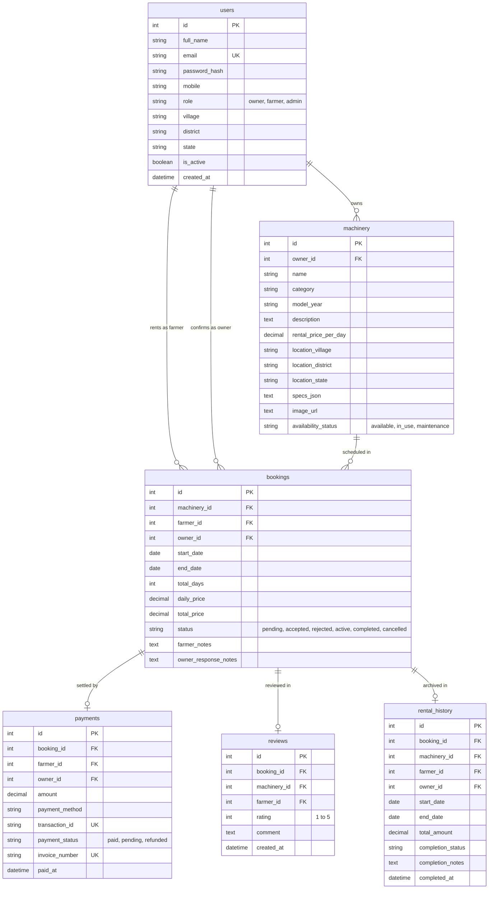
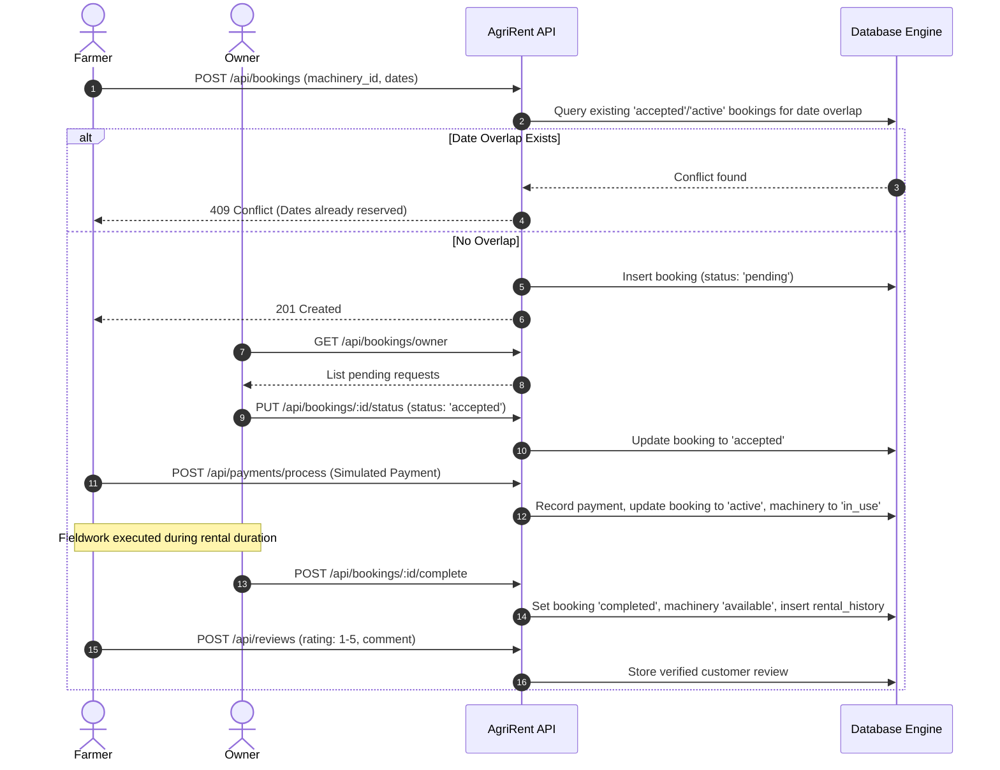
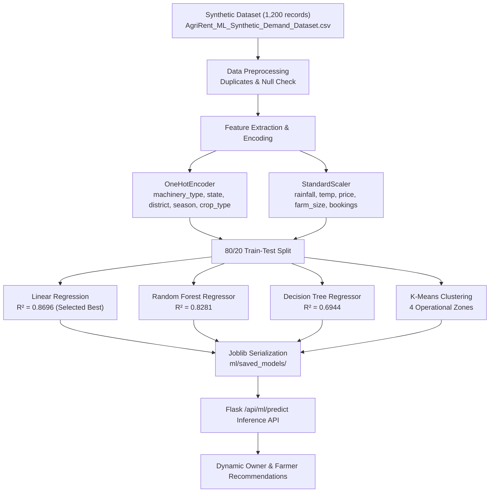

# AgriRent ML: System Architecture & Technical Specification

## 1. System Overview
AgriRent ML is a full-stack smart agricultural machinery rental web application powered by machine learning demand forecasting. It bridges the gap between machinery owners with underutilized equipment and small/marginal farmers needing access to mechanized implements.

### Core Objectives
1. **Multi-Role Experience**: Distinct authenticated dashboards, sidebars, metrics, and workflows for **Machinery Owners**, **Farmers / Field Owners**, and **Platform Administrators**.
2. **Conflict-Free Bookings**: Comprehensive calendar date verification preventing double bookings and schedule collisions.
3. **Machine Learning Demand Intelligence**: Live scikit-learn models predicting monthly machinery demand counts and clustering agricultural zones based on weather, previous bookings, pricing, and farm sizes.
4. **Transparent Settlements**: Simulated payments, GST tax breakdown invoices, and verified two-sided ratings.

---

## 2. Technology Stack

### Frontend
- **Framework**: React.js 18 with Vite
- **Styling**: Tailwind CSS (Agricultural green palette: Dark green `#14532d`, Emerald `#15803d`, Leaf `#22c55e`, Lime `#84cc16`, Cream `#fbfaf6`)
- **Routing**: React Router DOM v6 with role-based `ProtectedRoute` guards
- **Data Visualization**: Recharts (Revenue distributions, error metrics, demand comparisons)
- **Icons**: Lucide React

### Backend
- **Framework**: Python 3.x with Flask REST API
- **Authentication**: JWT (JSON Web Tokens) with 7-day expiration & Werkzeug password hashing
- **CORS**: Flask-CORS for cross-origin client interaction
- **Database Architecture**: Dual Database Engine
  - **Primary**: MySQL (InnoDB, Foreign Keys, UTF8mb4) via PyMySQL
  - **Zero-Config Fallback**: SQLite (`backend/agrirent.db`) automatically activated when MySQL server is not locally running, guaranteeing zero installation friction on any grading environment.

### Machine Learning
- **Dataset**: `AgriRent_ML_Synthetic_Demand_Dataset.csv` (1,200 synthetic demonstration records) located at `ml/dataset.csv`.
- **Algorithms**:
  1. **Linear Regression** (Best validation fit: R² = 0.8696, RMSE = 3.39)
  2. **Random Forest Regressor** (n_estimators=120, max_depth=12: R² = 0.8281, RMSE = 3.89)
  3. **Decision Tree Regressor** (max_depth=8: R² = 0.6944, RMSE = 5.19)
  4. **K-Means Clustering** (k=4 unsupervised segmentation of agricultural rental demand zones)
- **Persistence**: Joblib serialization (`ml/saved_models/`)

---

## 3. Database Schema

The database consists of 6 relational tables:

---

## 4. Conflict-Free Booking Workflow & Lifecycle

---

## 5. Machine Learning Demand Architecture

